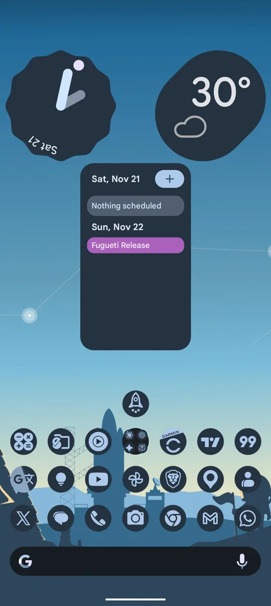
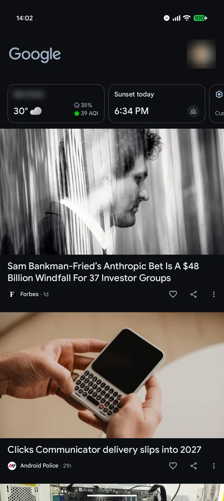
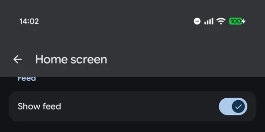

# Fugueti

[](https://github.com/victorwalter/fugueti-launcher/actions/workflows/release.yml)
[](COPYING)
<!-- Release and download count badges: shields.io cannot read private repositories,
     so they show "repo not found" until the repository is public. Uncomment them then.
[](https://github.com/victorwalter/fugueti-launcher/releases/latest)
[](https://github.com/victorwalter/fugueti-launcher/releases)
-->



Fugueti is an Android home app (launcher) based on
[Lawnchair 16](https://github.com/LawnchairLauncher/lawnchair/tree/16-dev), itself built on AOSP
Launcher3. It keeps everything Lawnchair does and adds 13 configurable home screen gestures, the
Google feed without third party bridges, and more reliable backups.

> The repository is private for now and will be open-sourced later, following Lawnchair's model.

## Features

- **Everything from Lawnchair 16:** icon packs, customizable app drawer and dock, Quickstep (Recents
  and system navigation integration), Material You, smartspace, global search…
- **13 home screen gestures:** swipe up/down/left/right, double tap, double tap + swipe up/down,
  two finger swipe up/down, pinch in/out, rotate clockwise/counterclockwise, with haptics,
  sensitivity and a gesture test pad. Extra actions: open app shortcut, open activity, launch
  intent. Details: [docs/gestures/README.md](docs/gestures/README.md).
- **Google feed (Discover)** on the page left of the home screen, through the small
  [Fugueti Feed](https://github.com/victorwalter/fugueti-feed) app (see below).
- **Backup and restore** that brings everything back (settings, gestures, fonts, saved wallpapers),
  restores Lawnchair backups and imports Nova Launcher backups, including Nova's gestures.
- **Search bar fixes:** the microphone opens your assistant (Gemini) and the "Google" dock search
  bar shows up with working mic and Lens buttons.
- Own package (`app.fugueti.launcher`), so it installs next to the official Lawnchair.

## Download

<p align="left">
  <a href="https://github.com/victorwalter/fugueti-launcher/releases/latest">
    <picture>
      <!-- Avoid image being clickable with slight workaround -->
      <source media="(prefers-color-scheme: dark)" srcset="docs/assets/badge-github.webp" height="60">
      
    </picture>
  </a>
</p>

1. Open the [latest release](https://github.com/victorwalter/fugueti-launcher/releases/latest) and
   download `FuguetiLauncher-<version>.github.release.apk`.
2. Install it (allow installs from your browser or file manager when Android asks).
3. Make Fugueti your home app: *Android Settings → Apps → Default apps → Home app → Fugueti*.

`SHA256SUMS.txt` in each release lets you check the download.

## Google feed (Discover)



The Google app only connects its feed to development builds or system apps, so regular builds of
any launcher need a small bridge app. Fugueti's is **Fugueti Feed**, signed with the same key:

1. Download `FuguetiFeed-<version>.release.apk` from the
   [Fugueti Feed releases](https://github.com/victorwalter/fugueti-feed/releases/latest) and
   install it. It has no permissions and only talks to Fugueti.
2. In Fugueti: long press the home screen → *Home settings* → *Home screen* → turn on
   **Show feed**.

   

3. Swipe right on the first home screen page to open the feed.

While the feed is on and Fugueti Feed is missing, Fugueti shows a red warning at the top of its
settings with a link to the download.

## Upstream base

| Component | Base |
|---|---|
| Lawnchair | `16-dev` (Launcher3 from Android 16, compiled against API 37) |
| AOSP Launcher3 | Android 16 (through Lawnchair). Moving to Launcher3 from Android 17 will follow Lawnchair's own rebase. |

## Building

Requirements: JDK 21 or newer, Android SDK with `platforms;android-37.2` and `build-tools;37.0.0`.

```bash
git clone --recurse-submodules https://github.com/victorwalter/fugueti-launcher
cd fugueti-launcher
./gradlew assembleLawnWithQuickstepGithubRelease
```

The APK lands in `build/outputs/apk/lawnWithQuickstepGithub/release/`.
Release signing reads `keystore.properties` (`storeFile`, `storePassword`, `keyAlias`, `keyPassword`),
which is git-ignored; without it the build is signed with the debug key.

Gesture engine unit tests:

```bash
./gradlew testLawnWithQuickstepGithubDebugUnitTest --tests 'app.fugueti.gestures.*'
```

## License

Lawnchair and Launcher3 code is under the Apache License 2.0 ([LICENSE.txt](LICENSE.txt)).
Fugueti code (`fugueti/` and the files marked "Modified by Fugueti Launcher contributors")
is under GPL-3.0-or-later ([COPYING](COPYING)), which makes the combined app GPL-3.0-or-later.
See also [README-LAWNCHAIR.md](README-LAWNCHAIR.md).
